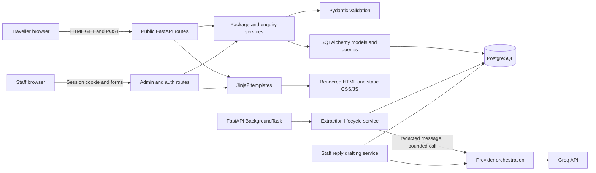
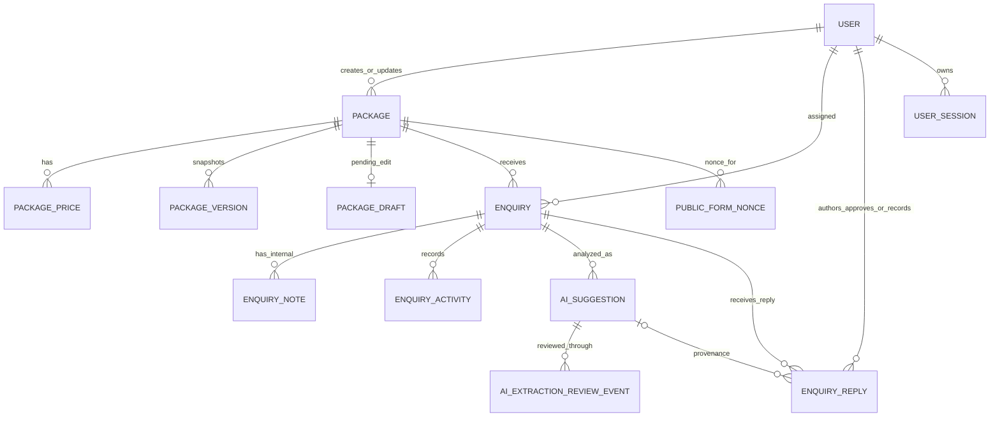
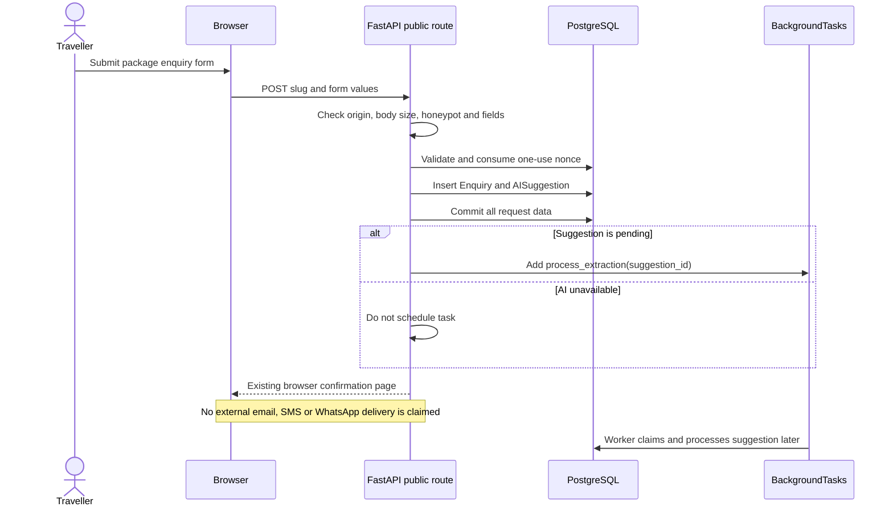
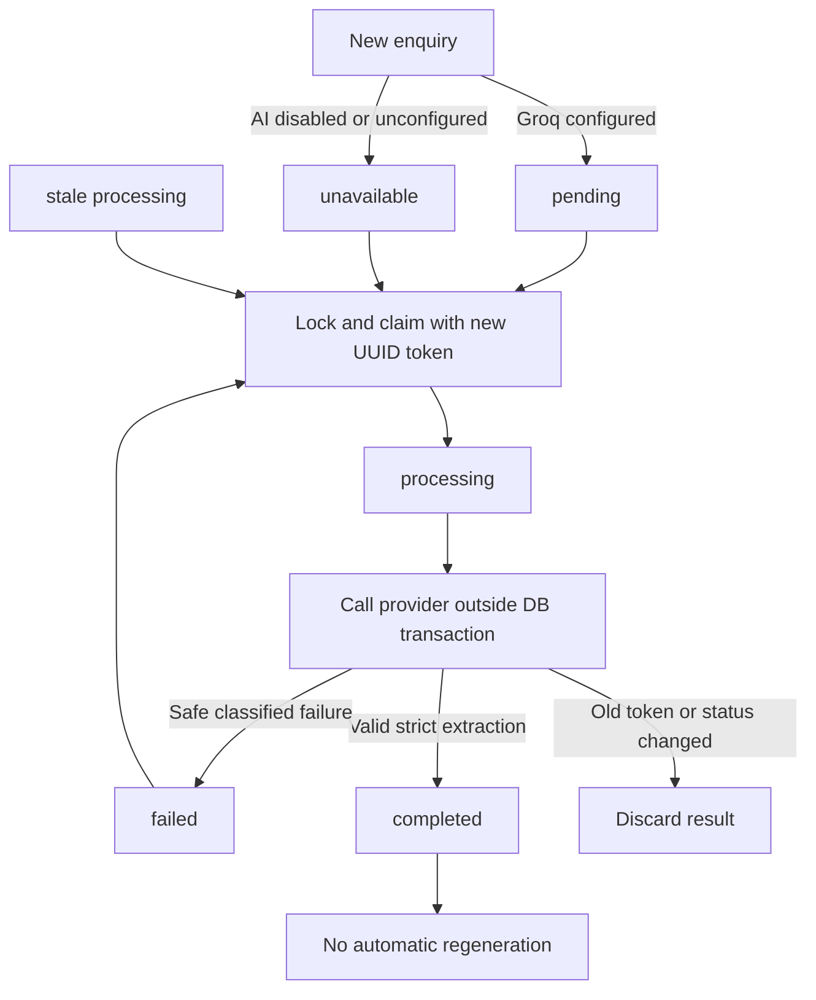
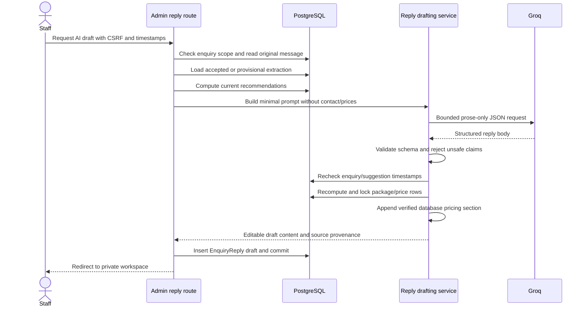
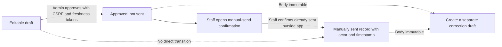

# Isocode Tours Technical Study Guide

**A source-grounded guide to the tour operator platform**  
Prepared for the application developer  
Source review date: 7 November 2026

> This guide explains the implementation that is present in this workspace. Statements about implementation are based on source and tests; operational results are identified as recorded verification, not as newly repeated tests. No live provider call or database access was used to prepare this guide.

## Table of contents

1. Project introduction
2. System architecture
3. Project folder structure
4. Database architecture
5. Package management CMS
6. Customer enquiry workflow
7. Staff enquiry management
8. AI extraction architecture
9. Package recommendation engine
10. AI reply drafting
11. Security architecture
12. Testing strategy
13. Deployment and operations
14. Important engineering decisions
15. Technical interview preparation

---

## Chapter 1: Project introduction

### What the application does

Isocode Tours is a server-rendered tour operator website and internal staff workspace. Travellers can browse published packages and submit a structured enquiry. Staff use one authenticated admin area to manage package content, follow up on enquiries, review AI assistance, prepare replies and record that an approved reply was sent manually outside the application.

The application is designed around a small but real operational problem: package edits currently require an external developer, while leads arrive in several channels and are manually tracked. The platform puts package content, seasonal prices and website enquiries into PostgreSQL so staff can manage the information and enquiries in one place.

### Users and objectives

| User | Main work in the application |
|---|---|
| Traveller | Browse published packages, filter by text/month, submit contact and trip details |
| Admin | Manage packages, publish/unpublish, review history, assign enquiries, approve replies, and use all staff workflows |
| Editor | Manage package drafts and work on enquiries, but cannot publish packages or approve replies |
| Consultant | Work with assigned enquiries, update status, add internal notes, review extraction, draft replies, and record eligible manual sending |

Business objectives are to reduce the cost and delay of package changes, centralize web enquiries, make staff response work visible, and use AI for bounded assistance without giving it authority to accept facts, publish content, quote invented prices or send messages.

### Technology stack

| Technology | Role here |
|---|---|
| Python | Application and business logic language |
| FastAPI | HTTP routing, dependencies, form parsing and ASGI application |
| SQLAlchemy 2.0 | Relational ORM, query construction, transactions and row locks |
| PostgreSQL | Persistent relational data, JSONB snapshots and database constraints |
| Alembic | Versioned schema changes |
| Pydantic | Strict validation and typed extraction/reply schemas |
| Jinja2 | Server-rendered HTML templates |
| HTML/CSS/vanilla JS | Accessible public and staff UI without a client framework |
| httpx | Bounded HTTP calls to AI providers |
| Pytest | Unit, route, integration and PostgreSQL-backed verification |
| Argon2 | Staff password hashing |

The frontend is intentionally conventional: FastAPI renders HTML on the server, CSS provides the responsive forest-green/cream design, and JavaScript is used only for limited progressive enhancements. Public pages are rendered from database records, which supports SEO-friendly URLs and avoids a separate client-side data application.

## Chapter 2: System architecture

### Overall architecture



The browser never talks directly to PostgreSQL or an AI provider. Routes handle HTTP concerns and authentication; services implement domain rules; schemas validate external or editable values; models map application data to database tables; templates render the final HTML.

### Layers and request lifecycle

1. **Browser** sends an HTTP request. Public pages do not require a login; staff pages carry an opaque session cookie.
2. **Middleware** rejects an oversized public enquiry request before it reaches the handler. The current cap is 16 KiB for the public package enquiry POST route.
3. **Route** resolves dependencies such as `get_db`, current staff and role requirements. It validates method-specific controls such as CSRF tokens.
4. **Service** applies business rules: published-package visibility, status transitions, package parsing, extraction lifecycle, recommendation scoring or reply state transitions.
5. **SQLAlchemy** constructs parameterized SQL and manages the transaction. Row locks are used for concurrent workflow changes.
6. **PostgreSQL** enforces foreign keys, unique constraints, check constraints, indexes and append-only protections implemented in the database.
7. **Jinja2** combines a context with a template and returns HTML. Private pages are marked `no-store` and `noindex` where implemented.

### Component communication

`app/main.py` creates the FastAPI app, installs the request-size middleware, mounts `/static`, and includes the public, authentication and admin routers. `app/config.py` loads environment and `.env` settings through Pydantic Settings. `app/database.py` builds the SQLAlchemy engine and request-scoped session factory. `app/templating.py` owns the shared template environment and formatting filters.

AI provider HTTP code lives in `app/services/ai/`. The provider-independent `GenerationRequest` and `GenerationResponse` types keep service code from depending on provider-specific response shapes. The orchestrator validates structured output and applies bounded retry/fallback policy. The extraction lifecycle and reply drafting service call this layer but apply their own domain validation afterward.

### Typical request path

For `GET /packages/munnar-thekkady-alleppey-houseboat`, `app/routes/public.py` calls `get_published_package()`. That helper uses a shared statement which filters `Package.status == "published"` and eagerly loads prices. The route issues a short-lived package-bound form nonce, commits it, and renders `packages/detail.html` using the shared package presentation.

For `POST /packages/{slug}/enquiries`, the route verifies request origin, parses the form, validates and consumes the one-use nonce, creates an `Enquiry` and initial `AISuggestion` in one transaction, commits, and then adds one `BackgroundTasks` item only if the suggestion is pending. The public confirmation does not wait for AI.

## Chapter 3: Project folder structure

The relevant source tree is:

```text
app/
  config.py
  database.py
  main.py
  create_staff.py
  seed_data.py
  templating.py
  middleware/
    public_form_limit.py
  models/
    base.py
    entities.py
  routes/
    public.py
    auth.py
    admin.py
  schemas/
    ai_extraction.py
    ai_reply.py
  services/
    authentication.py
    authorization.py
    session_store.py
    public_packages.py
    public_enquiries.py
    package_validation.py
    package_management.py
    package_publishing.py
    package_versions.py
    package_history.py
    package_restoration.py
    enquiry_queries.py
    enquiry_workflow.py
    enquiry_activity.py
    enquiry_reply_workflow.py
    ai_extraction_lifecycle.py
    ai_extraction_reviews.py
    package_recommendations.py
    ai_reply_drafting.py
    ai/
      base.py
      errors.py
      gemini_provider.py
      groq_provider.py
      http_common.py
      orchestrator.py
      provider_factory.py
      smoke_test.py
  templates/
    base.html
    home.html
    packages/
    admin/
    auth/
  static/
    css/
    js/
alembic/
  env.py
  versions/
tests/
docs/
outputs/
```

### How to follow a feature through the tree

**Public enquiry:** `routes/public.py` owns `POST /packages/{slug}/enquiries`; `services/public_enquiries.py` parses and validates fields, consumes the nonce and constructs an `Enquiry`; `services/ai_extraction_lifecycle.py` creates the suggestion record without committing; `models/entities.py` maps both records; `templates/packages/detail.html` and `_enquiry_form.html` render the form; `enquiry_confirmation.html` renders confirmation.

**Package publishing:** `routes/admin.py` validates the CSRF token and calls `services/package_publishing.py`; that service locks package then pending draft, validates the full payload with `package_validation.py`, replaces price rows, updates publication state and appends a complete snapshot through `package_versions.py`; the route commits the whole unit.

**Reply generation:** `routes/admin.py` calls `services/ai_reply_drafting.py` for prose, then `services/enquiry_reply_workflow.py` creates a regular draft with authenticated author and source suggestion attribution; the workspace template renders it beside separately labelled notes.

### Important configuration and operational files

- `requirements.txt`: Python dependencies.
- `.env.example`: variable names and safe placeholders; local `.env` is ignored by Git.
- `alembic.ini` and `alembic/env.py`: Alembic configuration and metadata loading.
- `README.md`: local setup, test database isolation, AI and operational guidance.
- `docs/manual-qa-checklist.md`: unchecked synthetic-data browser QA procedure, not proof that manual testing occurred.

## Chapter 4: Database architecture

### Model overview

All mapped classes are in `app/models/entities.py`, inherit the SQLAlchemy declarative `Base`, and use UUID primary keys. `TimestampMixin` in `app/models/base.py` supplies timezone-aware `created_at` and `updated_at` database timestamps to the main mutable records.

### Tables and responsibilities

| Model/table | Responsibility and important fields |
|---|---|
| `User` / `users` | Staff name, unique case-insensitive email, role, optional password hash, active flag |
| `UserSession` / `user_sessions` | Hash of opaque session token, CSRF token, creation/activity/expiry/revocation timestamps |
| `Package` / `packages` | Stable package code and slug, supported content JSON/text fields, status and publication metadata |
| `PackagePrice` / `package_prices` | Recurring month window, optional absolute date bounds, `Numeric(12,2)` amount, currency and basis |
| `PackageDraft` / `package_drafts` | One mutable pending JSON payload for a published package plus base/update timestamps |
| `PackageVersion` / `package_versions` | Immutable complete package snapshot, version number, reason and creator |
| `Enquiry` / `enquiries` | Original traveller message, contact and structured trip data, package/assignee/status/consent |
| `PublicFormNonce` / `public_form_nonces` | Hashed one-use token, package binding and expiry |
| `EnquiryNote` / `enquiry_notes` | Separate internal staff-only note and author |
| `EnquiryActivity` / `enquiry_activities` | Assignment/status event actor and old/new values |
| `EnquiryReply` / `enquiry_replies` | Reply body, author, draft/approved/manually-sent status and attribution timestamps |
| `AISuggestion` / `ai_suggestions` | Extraction lifecycle, raw and accepted JSON, provider/model, safe error and review metadata |
| `AIExtractionReviewEvent` / `ai_extraction_review_events` | Append-only accepted/corrected extraction history with actor and values |

### Relationships and deletion behavior



`Package` to `PackagePrice` is one-to-many; clearing a package’s price collection replaces its seasonal rows within the current transaction. `Package` to `PackageDraft` is one-to-one, enforced by a unique `package_id`. A package can have many immutable versions. An enquiry can have many notes, activities, suggestions and replies. Each suggestion has multiple review events. `EnquiryReply.source_ai_suggestion_id` is nullable, so manually authored or legacy replies remain valid.

Important foreign-key rules preserve audit history: deleting a package is constrained when package versions exist (`RESTRICT`); price and pending-draft rows cascade with their package; package references on enquiries use `SET NULL`; reply and activity enquiry references use `RESTRICT`; staff attribution often uses `SET NULL` to retain records if a user account is removed. The exact `ondelete` declarations are in `entities.py`.

### Constraints and indexes

PostgreSQL constraints protect invariants even if data bypasses a form: package status is one of draft/published/archived; duration must be positive when present; price months are 1–12; absolute date limits must be paired and ordered; enquiry dates must be paired and ordered; traveller counts and INR budget cannot be negative; reply status/timestamps must agree; AI lifecycle and failure codes are allowlisted; event types and status values are constrained.

Unique constraints include package code, package slug, version number per package, package draft per package, and session token hash. `User` has a unique lowercased email index. Query indexes support package status, package price/month lookup, enquiry status/creation and assignment, activity timeline, reply timeline/state, AI suggestion enquiry/state and review history.

### Snapshot JSON and prices

`Package.to_snapshot()` serializes the supported content fields plus every price row. `PackagePrice.to_snapshot()` serializes date bounds as ISO date strings and the decimal amount with exactly two places. This is important: a version is a snapshot of package and seasonal price state, not merely a title and description. Restoration validates the snapshot through the same canonical package payload parser and appends new versions rather than modifying old ones.

`AISuggestion` retains earlier/general workflow columns such as `package_suggestions`, `draft_reply` and `review_status` for compatibility. The current deterministic recommendation engine recomputes recommendations from live package/price rows rather than treating that legacy JSON list as authoritative. Current AI reply drafts are `EnquiryReply` rows. The extraction-review state (`extraction_review_status`) is separate from the older suggestion/reply review state.

### Transactions and locking

Routes own transaction commits; most service functions flush but do not commit. This allows the caller to commit a package plus its prices, or an enquiry plus nonce consumption plus lifecycle record, atomically. `SELECT ... FOR UPDATE` serializes writers. Package workflows lock `Package` before `PackageDraft`; enquiry/reply workflows lock enquiry before reply; extraction workers lock the suggestion and compare a UUID attempt token before persisting. A rollback discards the complete unit.

### Alembic

The current migration chain is:

```text
04773deed90c  initial tour schema
  -> 9cca1aa0f200  staff sessions and package drafts
  -> 6f4a2b1d9c70  enquiry workflow schema
  -> a8149f2c6e35  public form nonces
  -> c37a8b6d21f4  AI extraction review foundation
  -> e18bf6c4a920  review integrity and DB append-only guard
  -> 7a4e2d9c1f63  generation attempt fencing UUID
```

Alembic `env.py` loads the project metadata and uses the process `DATABASE_URL`. Tests reject a missing/non-PostgreSQL `TEST_DATABASE_URL`, reject the protected `isocode_tours` database name, set process `DATABASE_URL` from the test URL, and use a dedicated rollback-isolated engine. A recorded verification on 7 November 2026 reported test database head `7a4e2d9c1f63` and no autogenerate drift. This guide did not re-run Alembic.

### Entity relationship in words

One `Package` has many `PackagePrice` rows, versions, and enquiries. An enquiry optionally belongs to a package (the package can later be removed while the enquiry remains) and optionally belongs to a consultant. The enquiry holds original customer inputs; an `AISuggestion` belongs to it and stores raw AI results separately from accepted staff results. Each review produces an `AIExtractionReviewEvent`. `EnquiryReply` belongs to the enquiry and may reference the suggestion that seeded it. Users are attributed to package edits, notes, activities, replies, reviews and sessions.

## Chapter 5: Package management CMS

### Supported content

The actual `Package` schema supports `package_code`, `slug`, title, summary, description, destinations (JSON list), duration in days, hotel category, hotel details (JSON list), itinerary (JSON list), inclusions (JSON list), map URL, status, `scheduled_publish_at`, `published_at`, creator/updater IDs and timestamps. There is **no exclusions column**. Hotel and itinerary information is stored only when staff enter it; the application does not manufacture missing details.

### Create and edit

Admins and editors use `GET/POST /admin/packages/new` to create draft packages. Staff supply a unique code, while `slugify_title()` creates a title-derived slug. `parse_package_payload()` in `package_validation.py` is the canonical form parser. It validates text sizes, duration, map URL, nested hotel/itinerary rows, price decimals, month/date constraints and overlapping effective windows. Incomplete drafts may have no prices; publication later requires at least one valid price.

Drafts are edited through `GET/POST /admin/packages/{package_id}/edit`. Code and slug are stable. The route locks the package, compares the submitted `updated_at` token, validates the form and uses `update_draft_package()` to replace content and prices atomically. Archived packages are read-only; a staff member duplicates them into a new draft instead.

### Published edits and duplication

Editing a published package writes a `PackageDraft.draft_payload`; live `Package` and `PackagePrice` rows remain unchanged until an administrator publishes. The pending row has `base_updated_at` and its own `updated_at`, so stale package changes and concurrent edits can be detected. Admins see a review comparison and admins/editors can open a private preview.

`POST /admin/packages/{package_id}/duplicate` can duplicate draft, published or archived packages. `duplicate_package()` copies supported content and current live price rows only, assigns a `DUP-` code plus collision handling, makes a new slug, sets draft state, and attributes the copy to the current staff user. It does not copy the package ID, pending draft, version history or original authorship.

### Preview and publication

`GET /admin/packages/{package_id}/preview` shows a private draft/pending payload using the public package presentation and no-store/noindex headers. It cannot make pending content public. `GET /admin/packages/{package_id}/review` is admin-only and compares a published package with pending changes or shows a new draft for review.

Admins publish with `POST /admin/packages/{package_id}/publish`. `publish_package()` locks package then pending draft, verifies timestamps, parses the whole content-and-price payload, requires valid seasonal pricing, applies all supported fields, replaces prices, sets Published, clears schedule metadata and appends a version snapshot in one transaction. Unpublishing with `POST /admin/packages/{package_id}/unpublish` changes Published to Draft, clears publication timestamps, appends a snapshot, and rejects a package with pending changes.

### History and restoration

Admins can view `GET /admin/packages/{package_id}/versions`, one detail page, and a comparison page. Snapshot dates and decimals are parsed for display; malformed snapshots produce warnings rather than altering live data. `GET .../restore` is a confirmation page; `POST .../restore` validates and restores supported content and prices only. It preserves package code, slug, current publication state/timestamps, schedule and creator; it appends a before and after snapshot and attributes updater to the restoring admin.

**Scheduling limitation:** `scheduled_publish_at` is a stored field in package state and history, but this codebase has no scheduler/worker that automatically publishes packages at that time. It must not be described as an active timed publishing feature. An admin publish action is currently required.

**Business content limitations:** No separate exclusions field exists. No GST inclusion/exclusion policy is present. Hotel details, itinerary and inclusions can be blank. The system intentionally leaves such facts unspecified rather than inventing them.

Public package presentation states that amounts are per person, twin sharing, and that GST treatment is unspecified. The `PackagePrice.price_basis` still records the row-level basis; reply/recommendation code preserves the stored basis and does not turn it into a family total.

## Chapter 6: Customer enquiry workflow

### Public pages and route paths

| Method and path | Purpose |
|---|---|
| `GET /` | Homepage with one featured published package when available |
| `GET /packages` | Published package list; text search and optional month/year filters |
| `GET /packages/{slug}` | SEO-friendly published package detail and enquiry form |
| `POST /packages/{slug}/enquiries` | Validate and store a public enquiry |
| `GET /sitemap.xml` | XML sitemap with homepage, listing and published package URLs only |

`public_packages.py` centralizes the published-package SQL statement. Draft and archived packages are excluded at query time, not hidden only in the template. Seasonal month filtering uses stored `PackagePrice` month ranges and optional absolute date bounds. The route treats empty month/year strings as absent, validates ranges and rejects year without a month.

### Form data and consent

`_enquiry_form.html` requests name, email and/or phone, exact date bounds, flexible-date choice, adult/child/infant counts, optional INR budget, original message, required enquiry-response notice acknowledgement and optional WhatsApp consent. The raw message is stored exactly as decoded from the submitted textarea; structured fields are stored separately. The acknowledgement records notice version and accepted timestamp. WhatsApp timestamp is recorded only when the separate checkbox is checked; a phone number never implies consent. Marketing consent is not part of this workflow.

### Validation and anti-abuse

`parse_public_enquiry_form()` checks mandatory name/contact, email and phone shape/length, paired valid dates, end >= start, adults >= 1, child/infant nonnegative bounded counts, nonnegative two-decimal INR budget within Numeric(12,2), message length and required notice. `public_form_limit.py` caps the body at 16 KiB before the endpoint reads it. The form nonce is a high-entropy token; only its SHA-256 hash and package/expiry are stored. It expires after 30 minutes and is consumed with a conditional `DELETE ... RETURNING`, so replay fails.

The route checks Origin (or Referer if Origin is absent) against the application base URL and rejects `Sec-Fetch-Site: cross-site`. It also rejects a filled honeypot. The app does not implement a durable IP rate limiter; production must enforce one at a reverse proxy/hosting edge.

### Sequence



The enquiry, nonce consumption and initial suggestion are committed together. The background task is added after commit and receives only the suggestion ID. If task scheduling fails, a conditional update attempts to mark still-pending work failed; it cannot undo the saved enquiry or prevent the confirmation. FastAPI BackgroundTasks are in-process best-effort work, not a durable queue.

## Chapter 7: Staff enquiry management

### Inbox and workspace

`GET /admin/enquiries` uses `enquiry_queries.py` to filter and paginate enquiries in stable newest-first order. Search covers customer name, email, phone and original message; status, assignee and unassigned filters are supported. Page size and filters are bounded. Admins and editors see all matching work. Consultant SQL includes `assigned_to_id == current_user.id`.

`GET /admin/enquiries/{enquiry_id}` is the private workspace. It displays original message, submitted structured travel fields, notice/WhatsApp consent, package and current authoritative price rows, internal notes, activities, replies and AI-assisted information. Consultant record lookup includes the assignment predicate in the query; out-of-scope enquiries are returned as absent (404 behavior), reducing existence disclosure.

### Assignment and status

Assignment is admin-only. The service accepts active consultant-role accounts and records only actual changes in `EnquiryActivity`; repeated assignment to the same person does not create a duplicate event. Enquiry status transitions are validated in `enquiry_workflow.py` and recorded in the same transaction. Allowed transitions are:

```text
new -> in_progress | closed
in_progress -> waiting_customer | closed
waiting_customer -> in_progress | closed
closed -> in_progress
```

Admins/editors can change any visible enquiry; consultants can change assigned enquiries only. The enquiry row is locked and an expected `updated_at` is compared before mutation. Invalid transitions roll back without an activity event.

### Internal notes and event history

`EnquiryNote` is a separate internal-only table from `EnquiryReply`. Notes include author and timestamps. The note route applies CSRF, assignment scope and length/nonempty checks. There is no note edit/delete workflow in the implemented phase.

`EnquiryActivity` records assignment and status changes with actor, previous/new values and time. It avoids customer contact details and original message text. The activity stream does not add a row for every note or reply transition; notes/replies carry their own author, timestamps and state attribution. SQLAlchemy listeners reject normal ORM update/delete of activity records; database-level append-only protections apply to AI extraction review events, not generally to all tables. Listeners are not a substitute for database permissions against arbitrary direct SQL.

### Staff routes

| Method and path | Access/action |
|---|---|
| `GET /admin/login`, `POST /admin/login`, `POST /admin/logout` | Staff sign-in and sign-out |
| `GET /admin/enquiries` | Scoped inbox |
| `GET /admin/enquiries/{id}` | Scoped workspace |
| `POST /admin/enquiries/{id}/assignment` | Admin assignment |
| `POST /admin/enquiries/{id}/status` | Status update by permitted staff |
| `POST /admin/enquiries/{id}/notes` | Add private note |
| `POST /admin/enquiries/{id}/ai-extraction/retry` | Retry eligible extraction |
| `POST /admin/enquiries/{id}/ai-extraction/review` | Accept/correct extraction |
| `POST /admin/enquiries/{id}/replies` | Create manual reply draft |
| `POST /admin/enquiries/{id}/replies/ai-draft` | Generate AI-assisted reply draft |
| `POST /admin/enquiries/{id}/replies/{reply_id}/edit` | Edit only a draft |
| `POST /admin/enquiries/{id}/replies/{reply_id}/approve` | Admin-only approval |
| `GET .../manual-sent/confirm`, `POST .../manual-sent` | Confirm and record prior external sending |

Every state-changing staff form uses the session CSRF token. Workspace and other private screens set no-store/noindex headers.

## Chapter 8: AI extraction architecture

### Schema and validation

`EnquiryExtraction` in `app/schemas/ai_extraction.py` is a strict Pydantic model (`extra="forbid"`, strict types, version `1.0`). It covers destination; optional start/end dates and flexibility; original period text; adult/child/infant counts; decimal budget, currency and scope; preferences; and missing/ambiguous fields. It requires missing/ambiguous metadata for unknown or partial values. A month without a year stays ambiguous and does not become a guessed date. Currency is accepted only when explicit and supported by the project’s active ISO 4217 reference-data policy. Decimal input avoids float conversion and has a Numeric(12,2)-compatible range. `extraction_to_json()` emits JSONB-compatible dates/decimals as strings.

### Provider boundary

`GenerationRequest` includes prompt, response schema metadata, token cap and optional Pydantic output model. `GenerationResponse` normalizes provider, model, content, request identifier, time and parsed model. `provider_factory.py` chooses Gemini or Groq based on settings; the active extraction and reply services currently explicitly require Groq. Gemini adapter exists but has been deferred operationally. `orchestrator.py` retries only classified transient errors and may use Groq fallback for retryable Gemini failures when configured. Provider HTTP uses `httpx` with configured bounded timeout. Errors are normalized into safe enums; callers do not receive raw response bodies or exception text.

One configuration detail matters: `Settings.ai_provider` defaults to `gemini`, but extraction and AI reply availability checks require `AI_PROVIDER=groq` plus a Groq key and model. With the default/no-key configuration, the application still starts and enquiries work, but extraction is stored as unavailable and reply drafting is unavailable. Configure the active provider explicitly; do not assume the presence of a provider adapter means it is operationally enabled.

### Data minimization and redaction

`process_extraction(suggestion_id)` uses worker-owned SQLAlchemy sessions. The claim transaction locks the suggestion, checks its lifecycle and staleness, assigns a fresh `generation_attempt_id`, sets `processing`, and commits before network IO. The provider input is built from `Enquiry.original_message` only. Recognizable email/phone patterns are redacted. Contact columns, IP, consent, notes, prices and unrelated fields are not sent. The stored original message is never modified.

### Lifecycle and fencing



Only pending, failed, unavailable or genuinely stale processing work is claimable. A completed extraction is not automatically regenerated. The worker persists only if status remains processing and its UUID token still matches. Thus if Worker A is delayed, stale recovery creates token B, and B completes, A cannot overwrite B. Failures also pass the same fence. The original AI result remains in `extracted_data`; human-accepted/corrected values live separately in `accepted_extraction`.

### Human review

Admins/editors may review any enquiry; consultants only assigned enquiries; inactive staff are denied. The route parses corrected form fields into the same `EnquiryExtraction` schema and calls `accept_extraction()`. The service locks suggestion/enquiry, checks scope, updates accepted JSON and review attribution, and appends an `AIExtractionReviewEvent` atomically. Subsequent corrections append a new event with previous and new accepted values. A database trigger blocks UPDATE/DELETE of those event records. Acceptance is not reply approval, package publication or sending.

### Failure and recovery limits

Only safe machine codes are stored (`provider_unavailable`, `provider_timeout`, `invalid_provider_response`, `validation_failed`, `generation_failed`). Public acknowledgement does not wait for or depend on AI. Staff can retry failed/unavailable work and stale work. BackgroundTasks are process-local; after a restart, staff recovery is practical but not a durable delivery guarantee. No prompts, full outputs, API keys or raw exceptions are deliberately logged by the workflow.

## Chapter 9: Package recommendation engine

### Inputs and trust boundaries

`recommend_packages(session, extraction)` accepts an already validated `EnquiryExtraction` and queries the shared published-package statement with stored price rows. It does not call any AI provider and does not persist a quote. The staff workspace chooses accepted/corrected extraction first. If none exists, it can use completed raw extraction and labels the result provisional. Missing/invalid extraction produces no recommendations and a clear insufficient-information message.

### Destination matching

`_normalize_destination()` applies Unicode normalization, ASCII folding, case folding, replaces `&` with “and”, and normalizes punctuation/whitespace. `_destination_match()` compares against explicit `Package.destinations` first, then checks the complete requested phrase as a word-bounded phrase in the stored title. It does not rank a package merely because a generic term such as “hill”, “beach”, “tour” or “houseboat” overlaps. Packages that do not match a supplied destination are skipped.

### Seasonal and date matching

For exact dates, `_price_covers_dates()` checks each date in the inclusive range using `PackagePrice.applies_on()`. That method supports recurring month windows where start month > end month (e.g. October through March) and enforces optional absolute `valid_from` / `valid_until` bounds. The engine caps exact-range scanning at 366 days. One matching row yields a verified price. Multiple rows are treated as ambiguous; no price is chosen. No row that covers every day means staff confirmation.

For a stated month or month range without a year, `_explicit_month_window()` parses one or two named months and follows the calendar cyclically, so “October–March” becomes October, November, December, January, February, March. A recurring price row is eligible only if its month window covers all those months and it has no absolute date bounds. The code does not assign a year.

### Duration, travellers and budget

When both extraction dates exist, date-span days are compared with `Package.duration_days`: difference <= 1 adds 15 points; difference <= 3 adds 8; greater than 3 subtracts 4. Missing duration does not get invented.

Traveller counts do not establish availability or a group quote. If children or infants are present, the result explicitly says their fares/capacity are not defined and staff must confirm. No adult price is multiplied by family size.

Budget comparison is possible only when amount, currency `INR`, scope `per_person`, and a compatible stored INR `per_person` price are all known. Price <= budget adds 10 points; price above budget subtracts 8. Total-trip budget versus per-person price is not compared. Unknown currency/scope is unavailable, not zero, and there is no currency conversion.

### Score and output

| Signal | Score effect |
|---|---:|
| Destination match | +50 |
| One price period covers exact dates | +20 |
| Explicit recurring month window match | +15 |
| Duration within 1 day | +15 |
| Duration within 3 days | +8 |
| Duration differs by more than 3 days | -4 |
| Compatible verified per-person INR price within budget | +10 |
| Compatible verified price over budget | -8 |

Scores are ranking points, not confidence. Results are sorted deterministically by descending score, normalized title, package code and package ID. The engine returns no more than three. Because destination mismatch is excluded, no unrelated package is forced into the list. A minimum score of 15 is required. Every recommendation carries reasons, optional verified price evidence, period match and caveats.

**Synthetic example:** suppose a validated synthetic enquiry requests Kerala on 10–16 December, 2 adults, one child and INR 120,000 total. A published Kerala package whose recorded price period covers every date can be recommended. Its stored ₹32,500 per-person rate may be displayed only with its stored basis and season. The engine does not multiply by 2 or 3: child fare rules are absent and budget scope is total. It adds staff-confirmation and GST-treatment caveats. The example describes engine behavior, not a live quote.

## Chapter 10: AI reply drafting

### Context selection

`generate_reply_draft_content()` first verifies the authenticated actor is active and has an allowed role, checks consultant assignment scope, and compares the enquiry timestamp. It selects the latest suggestion. `_source_for_suggestion()` uses accepted extraction only if the review status is accepted/corrected and the payload validates. Otherwise a completed valid raw extraction may be used as provisional; a malformed or inconsistent accepted payload does not become trusted input.

The service obtains deterministic recommendations from the current database. Prompt context includes the original message after email/phone pattern redaction, validated extracted fields with a reviewed/provisional/no-extraction label, and factual package relevance without prices. Contact columns, internal notes and consent metadata are not included. It calls the provider with `AIReplyContent`, whose only accepted field is a bounded nonblank `body`.

### Price integrity

The generated body is validated by `_parse_provider_content()`. Provider output is rejected if it includes price-like amounts, pricing/discount/GST/availability/booking claims, or unsupported factual terms guarded by `_UNSAFE_PROSE`. Then the service rereads enquiry and suggestion timestamps. It recomputes recommendations from PostgreSQL, takes shared locks on selected package/price rows and verifies the recommendation signature remains stable. `_recommendation_section()` inserts the exact stored amount, currency, basis, season/period and notes using application code. It avoids calculating totals and includes GST/confirmation caveats.

The prompt contains no prices. If no compatible price exists, the appended section says pricing requires staff confirmation. Generated prose cannot enter the application-controlled pricing section as an alternate price. This is defense in depth; staff still review and edit the result before any approval.

### Reply lifecycle integration

The route then passes the generated body to `create_reply_draft()` as an ordinary `EnquiryReply` with author ID from the authenticated user, source suggestion ID, and expected timestamps. State starts as `draft`. A draft remains editable with `update_reply_draft()`, which locks enquiry then reply and compares both `updated_at` values. Approved and manually-sent bodies are not editable; corrections create a new draft with `supersedes_reply_id` provenance.

The provider request is synchronous in the staff POST route, bounded by configured timeout/retry. The database session remains open during the request, but no write lock is held; afterward the service checks freshness and briefly locks package/price rows while the route commits. Provider errors become safe messages and no reply row is created on failure. This can consume a web worker and DB connection for the bounded duration. No durable reply-generation queue exists.

### Reply drafting sequence



### Approval and manual recordkeeping



Approval is admin-only and has a separate approver/time. Editor/consultant cannot approve. Manual-sent recording is an application audit action only: the confirmation explicitly requires that the staff member already sent the content through an external channel. The app does not send anything. Consultants may record sending only for an assigned enquiry and a reply they authored; admin/editor can record for permitted enquiries. These transitions lock records, enforce role and timestamps, and update state plus attribution atomically.

## Chapter 11: Security architecture

### Authentication and sessions

Staff passwords are hashed with Argon2 through `services/authentication.py`. The login flow verifies a dummy hash for an unknown email to make the basic password-check work similar. A successful login issues a high-entropy opaque cookie token and stores only its SHA-256 hash in `UserSession`. Session tokens are rotated at login. Sessions have 30-minute idle and 8-hour absolute lifetime; logout revokes the server-side row. Cookie is HttpOnly, SameSite=Lax and Secure outside development/test according to `APP_ENV`. The secure cookie setting therefore depends on correctly setting production environment and HTTPS.

### Authorization

`services/authorization.py` provides active-user and role dependencies. Browser-page dependencies redirect missing/expired sessions to `/admin/login`, then enforce role. Role rules are checked in route/service layers, not just by hiding buttons. Consultant record queries include their own `assigned_to_id`; reply mutations also recheck scope while locking the enquiry.

### CSRF and public form defenses

Staff forms contain a synchronizer token stored in the server session and compared with constant-time comparison. Every state-changing staff form calls `require_valid_csrf()`. Public unauthenticated forms use same-origin Origin/Referer and Fetch Metadata checks plus package-bound, hashed, expiring, one-use nonces; they also use a honeypot and request-size/field-size limits. These controls do not replace deployment-level rate limiting.

### Database and template safety

SQLAlchemy expressions bind values as parameters, which avoids string-concatenated SQL for user input. Search escapes `%`, `_` and backslash before `ILIKE` matching. Jinja autoescaping is used for customer and staff text in HTML templates; raw message is displayed as text, not marked safe HTML. Private admin, historical and preview routes set no-store/noindex headers where applicable.

### AI privacy and audit

Extraction sends only a redacted original message; reply drafting sends minimum redacted source/context and no contact fields, notes, consent or price facts. Provider and model attribution is stored; safe failure codes are allowlisted. No API key is committed; `.env` is in `.gitignore`. AI output is untrusted and validated. Database-backed review events and package versions have append-only protections. `EnquiryActivity` and `PackageVersion` also have ORM mutation listeners, but listeners do not prevent arbitrary SQL; the extraction review event table has a PostgreSQL trigger/function for UPDATE/DELETE protection.

### Deployment-dependent protections

TLS termination, edge request-rate limiting, edge request-body cap, trusted proxy configuration, database network policy, encrypted backups, secret management, log redaction, retention/deletion process, monitoring and production incident response are deployment responsibilities. The repository does not demonstrate a production deployment. Do not treat test coverage as proof of these controls in a hosted environment.

## Chapter 12: Testing strategy

### Structure and fixtures

Tests are in `tests/`. `tests/conftest.py` requires `TEST_DATABASE_URL`, verifies it is PostgreSQL and not the protected development database name, then sets process `DATABASE_URL` from that value. It creates a dedicated test engine, confirms connection, and binds tests to a root transaction with a SQLAlchemy savepoint session. Each test rolls back, including application commits made through nested/savepoint behavior. The `supplied_packages` fixture creates only the exact two assignment packages in that transaction.

### Test layers

- **Schema/service tests:** extraction payload types, decimal/date rules, package parsing, status transitions, recommendation scoring and provider normalization.
- **Model tests:** relationships, uniqueness/check constraints, append-only rules and JSONB snapshots.
- **Route tests:** HTTP status, CSRF, role access, page rendering, validation errors, no-store headers and public visibility.
- **Integration tests:** SQLAlchemy + FastAPI with PostgreSQL fixture transactions; mocked provider HTTP or injected generators.
- **End-to-end workflow test:** synthetic public form submission, mocked extraction, staff acceptance, recommendations, mocked reply drafting, edit, approval and manual-sent recording.
- **Migration checks:** Alembic revision and `alembic check` detect schema drift without changing data.

Automated tests never need live Groq/Gemini. Provider tests use mocked httpx transports and synthetic values. Concurrency tests exercise locks and stale tokens against PostgreSQL where practical; they do not establish behavior under every production load pattern.

### Recorded test status

The latest recorded complete suite before this documentation task was **460 passed, 0 failed, 0 skipped**, with one existing Starlette/AnyIO `BlockingPortal` deprecation warning. The latest recorded focused release suite was 35 passed. These are historical verification records from 7 November 2026; the documentation task did not rerun pytest. The recorded Alembic revision was `7a4e2d9c1f63 (head)`, and `alembic check` reported no new upgrade operations. Manual browser QA was not performed; `docs/manual-qa-checklist.md` remains a checklist only.

### Test limitations

Rollback fixtures isolate database writes but do not test production backup/restore, external proxy behavior or actual provider availability. A successful mock does not prove real provider connectivity. The full suite is a strong regression signal, not a deployment-readiness guarantee.

## Chapter 13: Deployment and operations

### Local setup

1. Use Python 3.11 or newer and PostgreSQL 14 or newer.
2. Create/activate `.venv` and install `requirements.txt`.
3. Copy `.env.example` to `.env`; configure the local application database URL. `.env` is ignored by Git.
4. Apply `python -m alembic upgrade head` to the intended development database.
5. Optionally seed only the two assignment packages with `python -m app.seed_data`.
6. Create staff accounts interactively with `python -m app.create_staff`; there are no default credentials.
7. Run `uvicorn app.main:app --reload` and visit `http://127.0.0.1:8000`.

### Environment variables

| Variable | Use |
|---|---|
| `DATABASE_URL` | SQLAlchemy/Alembic database URL; keep secrets in a secret store in deployment |
| `APP_ENV` | `development`, `test` or production behavior; controls Secure cookie setting |
| `AI_ENABLED` | Enables/disables AI paths without disabling enquiry handling |
| `AI_PROVIDER` | Provider orchestration selector; Groq is the verified active provider, Gemini deferred |
| `GROQ_API_KEY`, `GROQ_MODEL` | Optional Groq configuration; required only when AI is enabled |
| `GEMINI_API_KEY`, `GEMINI_MODEL` | Configuration fields/adaptor exist, but Gemini is deferred |
| `AI_TIMEOUT_SECONDS` | Bounded provider timeout, validated 1–60 seconds |
| `AI_MAX_RETRIES` | Retry count, validated 0–2 |
| `AI_FALLBACK_ENABLED` | Controls eligible Gemini-to-Groq fallback in orchestration |
| `TEST_DATABASE_URL` | Required test-only PostgreSQL URL; never point it to development DB |

Avoid printing environment values. Example placeholders in docs must not be replaced with real credentials in committed files.

### Test database commands

The test fixture demands a separate database named `isocode_tours_test`, assigns process `DATABASE_URL` from `TEST_DATABASE_URL`, verifies `current_database()`, and rolls test changes back. Before running any database-backed tests or Alembic check, perform the README preflight and require the exact test DB name. Do not reuse the development database.

### Production startup

Production requires provisioning PostgreSQL, applying reviewed migrations before serving traffic, setting secrets through the host environment, creating accounts explicitly, enabling HTTPS and setting `APP_ENV=production`. Configure forwarded proxy headers only for a trusted proxy address. The project does not include a production deployment or managed scheduler.

### Background work and rate limits

Extraction uses FastAPI `BackgroundTasks`: tasks run after response in the application process and can be lost on process crash/restart. PostgreSQL row locks, lifecycle state and UUID fencing prevent duplicate active claims or stale result overwrites, but they do not guarantee delivery. Staff retry/recovery is the manual fallback. Do not describe it as a durable queue.

No reliable application-level IP rate limiting exists. Production reverse proxy/hosting edge must enforce rate and body limits. Trusted proxy configuration is necessary for origin/security checks to understand the external scheme/host.

### Backups, privacy and pricing operations

Use regular access-controlled, encrypted PostgreSQL backups. Verify custom-format dumps with `pg_restore --list` and practice restore into a separate database. Prefer provider point-in-time recovery when available. This repository contains no retention period; the business must define one and deletion procedures. GST treatment is unspecified in supplied package data; staff need confirmation before final quotations. Email, SMS and WhatsApp integrations are not implemented.

## Chapter 14: Important engineering decisions

| Decision | Reason and trade-off |
|---|---|
| FastAPI | Typed route dependencies and convenient server-rendered form handling; synchronous SQLAlchemy handlers still consume worker capacity |
| SQLAlchemy | One ORM/query/transaction layer and PostgreSQL row-lock support; developers must understand session scope and autoflush behavior |
| PostgreSQL | Strong constraints, transactions, JSONB snapshots, UUIDs and row locks; local setup needs a running DB |
| Pydantic | Strict external-data boundary for AI and form-adjacent structured values; strictness means corrections must conform rather than be silently coerced |
| Jinja2, not React | Server-side SEO, smaller stack and developer familiarity; interactive client-side behavior remains limited |
| Service layer | Keeps validation/workflow policy out of templates and allows tests to exercise business rules; discipline is needed to avoid route-level logic duplication |
| Database-backed prices | Authoritative rates are queryable, constrained and auditable; no price can be safely quoted beyond what the stored row says |
| Deterministic recommendations | Explainable ranking, testable and independent of model hallucination; matching is intentionally conservative and depends on content quality |
| FastAPI BackgroundTasks | Minimal infrastructure for an assignment-sized app; process-local and not durable |
| UUID attempt fencing | A stale worker cannot overwrite a newer attempt, even if it returns late; requires state/token checks in every persistence path |
| Human review | AI output remains a suggestion; staff acceptance, reply approval and manual-send recording are distinct events |
| Append-only audit records | Preserve historical package and extraction review decisions; ORM listeners alone are limited, so PostgreSQL trigger protects extraction review events |

Possible future alternatives include a durable job queue, a transactional outbox, a reviewed publication scheduler, SSO, an external email integration with delivery tracking, and a richer audit/activity model. Each adds operational or policy burden and should be introduced only when there is a product need.

## Chapter 15: Technical interview preparation

### Two-minute project introduction

> I built Isocode Tours, a server-rendered tour operator platform using FastAPI, SQLAlchemy 2.0, PostgreSQL and Jinja2. The business problem was that packages and seasonal rates were expensive and slow to update, while enquiries were scattered across channels and tracked manually. The application provides SEO-friendly public package pages, a versioned package CMS, a central enquiry inbox, staff roles, assignment and activity tracking, and a human-reviewed AI workflow. Public enquiries are committed independently of AI, and extraction runs as best-effort background work with a UUID attempt token to prevent stale workers from overwriting newer work. Recommendations are deterministic and use published package and `PackagePrice` rows. AI can draft prose, but the application adds verified prices and creates only an editable reply draft. An admin must approve it; the app never sends external messages. I used PostgreSQL constraints and transactions for integrity, Jinja for simpler SSR and testing, and a dedicated rollback-isolated PostgreSQL test database.

### Five-minute architecture walkthrough

Start at `app/main.py`: it builds FastAPI, installs the public request-size middleware and includes public/auth/admin routers. `app/config.py` loads typed settings; `app/database.py` creates the SQLAlchemy engine and request session. Public route handlers query published packages through shared helpers and render Jinja templates. The enquiry POST checks origin, nonce, honeypot, body size and fields, then commits enquiry, nonce consumption and AI suggestion atomically. After commit it schedules a worker with only the suggestion ID.

The worker uses its own sessions. It locks the suggestion, assigns a fresh UUID attempt, commits, redacts message contact patterns, and calls Groq outside the claim transaction. It validates the JSON with `EnquiryExtraction`, then locks again and persists only if status and attempt token still match. Staff can correct extraction; the service stores accepted data separately and appends review events.

Recommendations are pure deterministic service logic over published package and price rows. Reply drafting uses reviewed extraction or explicitly provisional extraction, sends no price facts to Groq, validates the prose, rereads timestamps and recomputes/locks price rows before application code appends the verified pricing section. The resulting reply is an ordinary draft. `enquiry_reply_workflow.py` locks enquiry then reply, checks freshness and enforces admin approval / separate manual-sent recordkeeping.

The data model is in `entities.py`. Alembic owns schema changes. Tests use only `TEST_DATABASE_URL`, a root transaction and per-test savepoints, with mocked providers. That design is easy to explain because each layer has one job, while the main operational trade-offs are process-local background tasks and synchronous staff reply generation.

### 40 interview questions and grounded answers

#### Architecture and application flow

**1. Why did you choose server-side rendering?**  
Jinja-rendered pages let the server return complete package HTML for SEO, keep the frontend to HTML/CSS/vanilla JS, and fit the developer’s existing experience. It avoids adding a separate SPA build and API state layer. Rich client interactions are consequently limited.

**2. What is the job of `app/main.py`?**  
It constructs the FastAPI app, registers `PublicEnquiryBodyLimitMiddleware`, mounts `/static`, includes public/auth/admin routers and defines health endpoints. Business behavior belongs in route/service modules, not the app entry point.

**3. How does the public package query ensure drafts stay hidden?**  
`public_packages_statement()` includes the `Package.status == "published"` predicate. Listing, detail lookup and recommendation selection reuse this rule, so a draft is absent before a template sees it.

**4. Why separate routes and services?**  
Routes translate HTTP/form state, dependencies and responses. Services own validation and domain transitions. For example, the admin publish route checks CSRF and commits, while `publish_package()` locks rows, validates payload and applies state.

**5. How is request database session lifetime controlled?**  
`get_db()` creates a `SessionLocal`, yields it to FastAPI dependencies and closes it in `finally`. Worker tasks use separate worker-owned sessions rather than retaining the request session.

#### Database and transactions

**6. Why use PostgreSQL JSONB for package snapshots?**  
A complete package snapshot includes nested hotel/itinerary/inclusion data and seasonal prices. JSONB stores the versioned shape as one historical object while relational package/price tables remain the current source of truth.

**7. Why is price stored as `Numeric(12,2)`?**  
Money should not use binary floating point. Decimal precision is preserved for stored rates, snapshots, validation and display.

**8. What is the difference between `PackageDraft` and `PackageVersion`?**  
`PackageDraft` is one mutable pending change for a published package. `PackageVersion` is an immutable historical snapshot appended on publish/unpublish/restore. They serve different workflow stages.

**9. How is an edit made atomic?**  
The route opens a transaction around package fields and replacement seasonal-price rows. The service flushes but does not commit. If parsing, constraint checking or insertion fails, rollback prevents partial content/pricing changes.

**10. What does `FOR UPDATE` do in these workflows?**  
It locks a selected row until transaction end so another writer cannot concurrently make the same state decision. For publishing, package is locked before its pending draft. Reply workflow locks enquiry before reply.

**11. Why preserve `base_updated_at` on a pending draft?**  
It records which live package revision the draft started from. Publishing can reject a pending payload whose base no longer matches the current published row, avoiding silent overwrite of newer live edits.

**12. How are old version records protected?**  
Package versions have ORM update/delete listeners and package deletion is restricted by a foreign key. Extraction review events additionally use a PostgreSQL trigger/function to reject UPDATE and DELETE. ORM listeners alone do not protect arbitrary SQL.

#### Package CMS

**13. How is a seasonal price window represented?**  
Each row stores start/end month plus optional paired absolute dates. If start month is greater than end month, it crosses year-end; `10` to `3` represents October–March. `applies_on()` checks both recurring month and absolute bounds.

**14. What happens when an editor changes a published package?**  
The route stores a validated `PackageDraft.draft_payload`. Current `Package` and `PackagePrice` remain unchanged; only an admin can later publish the pending changes.

**15. How does duplication avoid copying pending edits?**  
The duplication route locks/loads the source and the service copies the source’s current live fields/prices. It builds a new draft with new code/slug and does not copy `PackageDraft` or version history.

**16. Is scheduled publishing automatic?**  
No. `scheduled_publish_at` is a field and appears in snapshots, but the repository has no scheduler that executes publication at that time. Automatic timed publication is an incomplete operational feature.

**17. What happens when a package is unpublished?**  
The admin workflow changes status from Published to Draft, clears publication timestamps, appends a version snapshot, and blocks if a pending draft exists. It is not archived.

**18. Does the package schema include exclusions?**  
No. It has inclusions, hotels, itinerary and other supported fields, but no exclusions column. The application cannot present a structured exclusions list from this schema.

#### Enquiry and security

**19. How does the public form prevent replay?**  
The server generates a high-entropy nonce, stores only its hash bound to package and expiry, then consumes it with a conditional delete. A second submit with the same nonce fails.

**20. Why also check Origin and use a honeypot?**  
The origin/fetch-metadata check helps reject cross-site form submission, while the honeypot catches simple automated form bots. Neither replaces proxy rate limiting.

**21. Does a phone number imply WhatsApp consent?**  
No. Consent is a separate checkbox and timestamp. The presence of a phone number alone does not set the consent flag.

**22. How are customer original message and structured fields related?**  
The textarea is stored unchanged in `Enquiry.original_message`; dates, traveller counts and INR budget have dedicated columns. AI extraction is separate JSON, so correcting an extraction never mutates what the customer wrote.

**23. How are consultants restricted to assigned enquiries?**  
The inbox and detail queries apply `Enquiry.assigned_to_id == staff.id` for consultants, and mutation services repeat that check under a lock. Hiding a row or button is not the security boundary.

**24. What does CSRF protection do here?**  
Staff sessions store a random CSRF token. Forms submit it, and `require_valid_csrf()` uses constant-time comparison. It protects state-changing POST actions against cross-site form submissions where browser cookies are attached.

**25. What does no-store/noindex mean?**  
`Cache-Control: no-store` asks caches not to retain private page responses; `X-Robots-Tag`/template robots metadata asks search crawlers not to index them. It is not authentication and does not protect a leaked URL by itself.

#### AI extraction and recommendations

**26. Why use a Pydantic extraction model?**  
Provider JSON is untrusted. `EnquiryExtraction` forbids extra fields, uses strict types, validates ISO dates and Decimal budget, bounds counts, validates currency and requires explicit missing/ambiguous metadata. Invalid results fail instead of being silently repaired.

**27. Why store raw and accepted extraction separately?**  
Raw is what the model proposed; accepted is what a staff member reviewed. Keeping both preserves provenance and prevents AI from silently changing customer-submitted or staff-approved facts.

**28. How does attempt fencing prevent stale workers?**  
Each claim sets a random UUID in `generation_attempt_id`. Before success or failure persistence, the worker locks the suggestion and checks both `processing` state and matching UUID. A late worker with an old token is discarded.

**29. What happens if Groq times out during extraction?**  
The provider layer normalizes timeout to a safe error; lifecycle processing persists `failed` with `provider_timeout` if its attempt token remains current. The enquiry and browser confirmation were already committed and do not depend on the provider.

**30. Are background tasks durable?**  
No. FastAPI `BackgroundTasks` run in the app process and can be lost on restart. The state plus staff retry/stale recovery help recover but do not guarantee delivery as a queue/outbox would.

**31. How does the recommendation engine avoid hallucinated packages?**  
It does not ask an LLM. It queries published packages and applies deterministic destination, dates, season, duration and budget logic. It returns at most three and excludes packages that do not match a supplied destination.

**32. Why not present a per-person rate as a family total?**  
The database may not define child fares, infant fares, room occupancy or taxes. Multiplying an adult rate by party size would create unsupported precision. The workspace preserves the stored basis and says staff must confirm group pricing.

#### Reply drafting and reliability

**33. How does AI reply generation keep prices authoritative?**  
The prompt excludes prices. The returned prose is schema-checked and scanned for price/availability claims. The application then recalculates current recommendations and appends stored price amounts/basis/season from PostgreSQL.

**34. What if package prices change while reply generation is running?**  
After the provider call, the service checks enquiry/suggestion timestamps, recomputes recommendations, locks selected package and price rows, and verifies the selected price signature remains stable. If recommendations changed during locking, it retries a bounded number of times or returns a conflict.

**35. Can a generated reply be sent automatically?**  
No. It creates an ordinary editable `draft`. Admin approval is a distinct state change and still does not send anything. Manual-sent recording is a separate staff assertion after an external send already occurred.

**36. What if two staff edit the same reply?**  
The update form contains expected enquiry and reply timestamps. The workflow locks both records and compares the submitted timestamps. A stale editor receives a conflict instead of overwriting the more recent draft.

**37. Why is reply approval admin-only?**  
The implemented policy separates drafting from authorization to approve customer-facing content. The service checks role, locks the reply and only accepts a draft transition. Approver ID/time are attributed to the authenticated admin.

**38. What happens if background task scheduling fails after enquiry commit?**  
The route keeps the committed enquiry/nonce/suggestion and returns the same confirmation. It best-effort marks only a still-pending suggestion with no active attempt token as `failed/generation_failed`; it never overwrites newer work.

#### Testing and operations

**39. How do tests avoid changing the development database?**  
`conftest.py` requires `TEST_DATABASE_URL`, checks PostgreSQL and rejects `isocode_tours`, assigns `DATABASE_URL` only inside the test process, verifies connectivity, and uses one root transaction plus per-test savepoints and rollback.

**40. What would you improve next for production?**  
I would assess durable task delivery (outbox/queue), automatic scheduled publishing, edge rate limiting, backup restoration drills, a defined traveller-data retention policy and real deployment monitoring. I would do that after validating workload and operational needs rather than adding infrastructure speculatively.

### Additional scenario questions

**What if an AI provider returns valid JSON but unknown fields?**  The extraction/reply schemas forbid extras, so validation fails with a safe code; unknown fields are not silently dropped.

**What if two consultants try to claim the same enquiry?**  Assignment is admin-controlled. The service locks the enquiry and validates the assignee; only one assignment update commits at a time, and actual changes receive activity events.

**What if a consultant opens another consultant’s enquiry URL directly?**  The SQL query filters by their own assignment and the route returns the same not-found style for inaccessible records.

**What if the public customer checks WhatsApp consent but the phone is invalid?**  The form validation rejects invalid phone format/count. Consent timestamp is only persisted on valid successful form submission when the explicit checkbox is checked.

**What if there are two price rows that both seem to apply?**  Recommendation pricing is marked ambiguous and omitted; the system asks staff to confirm instead of choosing arbitrarily.

**What if the enquiry mentions “December” without a year?**  The extraction marks `travel_year` ambiguous and leaves exact calendar dates null. The recommendation engine can use a recurring month window only when a clear explicit month statement is available; it does not invent a year.

**What if an enquiry has a total family budget but only per-person adult pricing exists?**  Budget scoring is skipped, and no group total is calculated. A per-person rate may be shown with its basis and a staff-confirmation caveat.

**What if an admin restores old package content while package is Published?**  The service keeps current Published status and publication timestamp, preserves stable code/slug, refuses archived or pending-draft packages, validates historical content/prices, and appends snapshots before and after the restore.

**What if a manual-send POST is repeated?**  The service requires current approved status, locks the reply, checks timestamps and rejects any state other than `approved`, so attribution is not silently overwritten.

**What is not proven by 460 passing tests?**  Tests do not prove production provider availability, browser/device behavior, proxy configuration, operational backups, legal policy compliance, or behavior at all concurrent-load levels. Manual browser QA remains outstanding.

---

## Source and verification notes

The guide is based on the source tree in this workspace, including `app/`, `alembic/`, `tests/`, `README.md` and `docs/manual-qa-checklist.md`. The last recorded test and migration results are dated 7 November 2026 and were not rerun for this documentation artifact. No database query, migration, source-code behavior change or live AI request was performed while authoring this guide. Where the implementation is absent (automatic scheduled publication, external messaging, production rate limiting and durable task queue), the guide says so explicitly.

